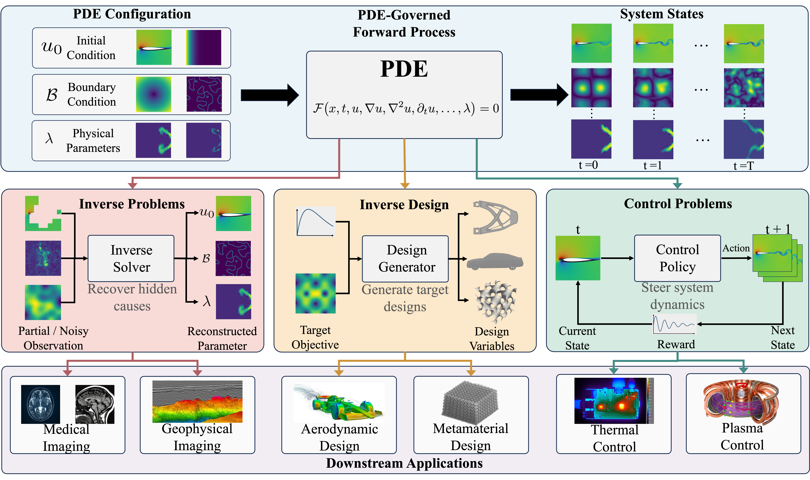

# Awesome AI for Inverse PDE Problems

A curated collection of papers and code on **inverse problems**, **inverse design**, and **PDE control**. This repository accompanies our survey:

**[Harnessing AI for Inverse Partial Differential Equation Problems: Past, Present, and Prospects](https://arxiv.org/abs/2605.16966)**

Zhentao Tan, Yuze Hao, Boyi Zou, Mingsheng Long, Yi Yang, and Gang Bao.

**[Website](https://tanpig-x.github.io/Awesome-Inverse-PDE-Problems/) · [Paper](https://arxiv.org/abs/2605.16966) · [PDF](https://arxiv.org/pdf/2605.16966) · [Full Paper List](https://tanpig-x.github.io/Awesome-Inverse-PDE-Problems/#view-gallery)**

<p align="center">
  
</p>

The website provides a searchable archive of **190 studies**, including **74 papers with author-associated code**, together with [benchmarks and quantitative comparisons](https://tanpig-x.github.io/Awesome-Inverse-PDE-Problems/#view-results) and [method applicability](https://tanpig-x.github.io/Awesome-Inverse-PDE-Problems/#view-applicability).

**Latest update · 11 October 2026:** The recent-publication collection now includes 62 verified journal and conference papers from 2025–2026. Refreshed 47 existing entries and added 15 author-associated code links.

## Contents

- [Inverse Problems](#inverse-problems)
- [Inverse Design](#inverse-design)
- [PDE Control](#pde-control)
- [Contributing](#contributing)
- [Citation](#citation)

The tables below highlight recently verified publications from 2025–2026. [Browse the published-paper collection →](https://tanpig-x.github.io/Awesome-Inverse-PDE-Problems/#view-gallery?collection=published&sort=newest) Code links point to author-associated repositories or official archives. A dash means that no public implementation has been verified in this collection.

## Inverse Problems

Recover unknown parameters, fields, or dynamics from observations. [Browse all papers →](https://tanpig-x.github.io/Awesome-Inverse-PDE-Problems/#view-gallery?task=inverse_problems)

| Year | Venue | Paper | Code |
| --- | --- | --- | --- |
| 2026 | UAI | [Adaptive Fourier Decomposition-guided Neural Operator Design for Inverse PDE Problems](https://proceedings.mlr.press/v337/song26a.html) | — |
| 2026 | Nature Communications | [Going with the flow to solve for symmetry-driven PDE dynamics with physics-informed neural networks](https://www.nature.com/articles/s41467-026-75936-3) | [Code](https://github.com/mihaliskavousanakis/PINNs-for-DAEs) |
| 2026 | Communications Physics | [Regularization by denoising diffusion models for solving inverse PDE problems with application to full waveform inversion](https://www.nature.com/articles/s42005-026-02677-6) | [Code](https://github.com/lu-group/red-diffeq) |
| 2026 | Transactions on Machine Learning Research | [ProJo4D: Progressive Joint Optimization for Sparse-View Inverse Physics Estimation](https://openreview.net/forum?id=pqvVrqlXCZ) | [Code](https://github.com/daniel03c1/ProJo4D) |
| 2026 | Transactions on Machine Learning Research | [Solving inverse problems via diffusion-based priors: An approximation-free ensemble sampling approach](https://openreview.net/forum?id=qN8ASsfjKs) | — |
| 2026 | npj Artificial Intelligence | [AgenticSciML: Collaborative Multi-Agent Systems for Emergent Discovery in Scientific Machine Learning](https://www.nature.com/articles/s44387-026-00102-5) | [Code](https://github.com/Qile-J/AgenticSciML) |
| 2026 | Nature Communications | [FunDiff: diffusion models over function spaces for physics-informed generative modeling](https://www.nature.com/articles/s41467-026-72292-0) | [Code](https://github.com/sifanexisted/fundiff) |
| 2026 | ICLR | [Physics-Constrained Fine-Tuning of Flow-Matching Models for Generation and Inverse Problems](https://proceedings.iclr.cc/paper_files/paper/2026/hash/e8b782d03c623e3e587fdbcc521dd581-Abstract-Conference.html) | [Code](https://github.com/jantauberschmidt/PCFT) |
| 2026 | Journal of Computational Physics | [BiLO: Bilevel Local Operator Learning for PDE Inverse Problems](https://doi.org/10.1016/j.jcp.2026.114679) | [Code](https://github.com/Rayzhangzirui/BILO) |
| 2026 | SIAM Journal on Scientific Computing | [Solving Forward and Inverse Partial Differential Equation Problems on Unknown Manifolds via Physics-Informed Neural Operators](https://epubs.siam.org/doi/10.1137/24M1675254) | [Code](https://github.com/lu-group/manifold-deeponet) |
| 2025 | NeurIPS | [Solving and Learning Partial Differential Equations with Variational Q-Exponential Processes](https://proceedings.neurips.cc/paper_files/paper/2025/hash/fe4f40a6eba58a1800cb694d89206e1f-Abstract-Conference.html) | [Code](https://github.com/lanzithinking/Diff_QEP) |
| 2025 | NeurIPS | [Guided Diffusion Sampling on Function Spaces with Applications to PDEs](https://proceedings.neurips.cc/paper_files/paper/2025/hash/b8a28baaa25cebfa9345a8a2edf7f19d-Abstract-Conference.html) | [Code](https://github.com/neuraloperator/FunDPS) |
| 2025 | ICCV | [Toward Material-Agnostic System Identification from Videos](https://openaccess.thecvf.com/content/ICCV2025/html/Zhao_Toward_Material-Agnostic_System_Identification_from_Videos_ICCV_2025_paper.html) | [Code](https://github.com/yizhou42/MASIV) |
| 2025 | Journal of Computational Physics | [DGenNO: a novel physics-aware neural operator for solving forward and inverse PDE problems based on deep, generative probabilistic modeling](https://doi.org/10.1016/j.jcp.2025.114137) | [Code](https://github.com/pkmtum/DGenNO) |
| 2025 | npj Computational Materials | [Physics-informed neural operators for generalizable and label-free inference of temperature-dependent thermoelectric properties](https://www.nature.com/articles/s41524-025-01769-1) | — |
| 2025 | AISTATS | [Invertible Fourier Neural Operators for Tackling Both Forward and Inverse Problems](https://proceedings.mlr.press/v258/long25a.html) | [Code](https://github.com/BayesianAIGroup/iFNO) |
| 2025 | Computer Methods in Applied Mechanics and Engineering | [Multi-Objective Loss Balancing for Physics-Informed Deep Learning](https://doi.org/10.1016/j.cma.2025.117914) | [Code](https://github.com/rbischof/relative_balancing) |
| 2025 | ICLR | [PIED: Physics-Informed Experimental Design for Inverse Problems](https://proceedings.iclr.cc/paper_files/paper/2025/hash/f7bdb4331e6e8af897f0c8891585e4f0-Abstract-Conference.html) | [Code](https://github.com/apivich-h/pied) |
| 2025 | ICLR | [Physics-Informed Deep Inverse Operator Networks for Solving PDE Inverse Problems](https://proceedings.iclr.cc/paper_files/paper/2025/hash/cbe1fd3136e0f049bb8bc104231ccb99-Abstract-Conference.html) | [Code ZIP](https://proceedings.iclr.cc/paper_files/paper/2025/file/cbe1fd3136e0f049bb8bc104231ccb99-Supplemental-Conference.zip) |
| 2025 | Journal of Scientific Computing | [ODE-DPS: ODE-based diffusion posterior sampling for linear inverse problems in partial differential equation](https://link.springer.com/article/10.1007/s10915-025-02790-8) | — |

## Inverse Design

Find geometries, materials, or physical configurations that achieve a target response. [Browse all papers →](https://tanpig-x.github.io/Awesome-Inverse-PDE-Problems/#view-gallery?task=inverse_design)

| Year | Venue | Paper | Code |
| --- | --- | --- | --- |
| 2026 | IEEE Transactions on Evolutionary Computation | [Neural Operator-enabled Topology-informed Evolutionary Strategy for PDE-Constrained Optimization](https://ieeexplore.ieee.org/document/11618686/) | [Code](https://github.com/xmh3698/notes-pde-opt) |
| 2026 | ICML | [Generative Inverse Design with Abstention via Diagonal Flow Matching](https://proceedings.mlr.press/v306/de-campos26a.html) | [Code](https://github.com/migueldecampos/diagcfm) |
| 2026 | ICML | [AutoMS: Multi-Agent Evolutionary Search for Cross-Physics Inverse Microstructure Design](https://proceedings.mlr.press/v306/zhao26bh.html) | [Code](https://github.com/tuple1126/AutoMS) |
| 2026 | CVPR | [PhysGen: Physically Grounded 3D Shape Generation for Industrial Design](https://openaccess.thecvf.com/content/CVPR2026/html/You_PhysGen_Physically_Grounded_3D_Shape_Generation_for_Industrial_Design_CVPR_2026_paper.html) | [Code](https://github.com/kasvii/PhysGen) |
| 2026 | Nature Machine Intelligence | [Algebraic language models for inverse design of metamaterials via diffusion transformers](https://doi.org/10.1038/s42256-026-01218-8) | [Code](https://github.com/li-zhengz/DiffusionMetamaterials) |
| 2026 | Smart Materials in Manufacturing | [Guided diffusion for fast inverse design of voxel-based mechanical metamaterials](https://www.sciencedirect.com/science/article/pii/S2772810226000061) | [Code ZIP](https://wutomwu.github.io/publications/2026-Metamaterial/code.zip) |
| 2026 | Computer Methods in Applied Mechanics and Engineering | [Design-GenNO: A physics-informed generative model with neural operators for inverse microstructure design](https://www.sciencedirect.com/science/article/pii/S0045782525008692) | [Code](https://github.com/yaohua32/Design-GenNO) |
| 2026 | Inverse Problems and Imaging | [Weak adversarial networks for interface optimal design problems under physical constraints](https://www.aimsciences.org/article/doi/10.3934/ipi.2026019) | [Code](https://github.com/BoyiZou/WANCO-Weak-adversarial-networks-for-constrained-optimization-problems) |
| 2026 | Nature Communications | [Data-driven inverse design of multifunctional bicontinuous multiscale structures](https://www.nature.com/articles/s41467-025-68089-2) | [Code](https://github.com/llwang91/L-BOM) |
| 2026 | Nature Machine Intelligence | [Current-diffusion model for metasurface structure discoveries with spatial-frequency dynamics](https://www.nature.com/articles/s42256-025-01162-z) | [Code](https://github.com/ISEE213/Current-Diffusion-Model) |
| 2026 | npj Computational Materials | [Toward a robust and generalizable metamaterial foundation model](https://www.nature.com/articles/s41524-025-01925-7) | — |
| 2026 | Advanced Optical Materials (Review) | [Inverse design in nanophotonics via representation learning](https://advanced.onlinelibrary.wiley.com/doi/abs/10.1002/adom.202502062) | — |
| 2026 | ACS Photonics | [Inverse design of diffractive metasurfaces using diffusion models](https://pubs.acs.org/doi/10.1021/acsphotonics.5c01384) | [Code](https://github.com/liavhen/metagen) |
| 2025 | NeurIPS Datasets and Benchmarks | [EngiBench: A Framework for Data-Driven Engineering Design Research](https://proceedings.neurips.cc/paper_files/paper/2025/hash/0013efa1327c079e73154d4061c3a396-Abstract-Datasets_and_Benchmarks_Track.html) | [Code](https://github.com/IDEALLab/EngiBench) |
| 2025 | NeurIPS | [Training-Free Constrained Generation With Stable Diffusion Models](https://proceedings.neurips.cc/paper_files/paper/2025/hash/2774a3b52d436b5930da660dd2b32b3a-Abstract-Conference.html) | [Code](https://github.com/RAISELab-atUVA/Constrained-Stable-Diffusion) |
| 2025 | NeurIPS | [3DID: Direct 3D Inverse Design for Aerodynamics with Physics-Aware Optimization](https://proceedings.neurips.cc/paper_files/paper/2025/hash/8fffba1c70615c74f68f56290464590e-Abstract-Conference.html) | — |
| 2025 | Small Methods | [HiLAB: A Hybrid Inverse-Design Framework](https://onlinelibrary.wiley.com/doi/abs/10.1002/smtd.202500975) | [Code](https://github.com/Mr-MZN/HiLAB-A-Hybrid-Inverse-Design-Framework) |
| 2025 | Applied Soft Computing | [AutoTandemML: active learning enhanced tandem neural networks for inverse design problems](https://www.sciencedirect.com/science/article/pii/S156849462501141X) | [Code](https://github.com/lukagrbcic/AutoTandemML) |
| 2025 | International Journal of Mechanical Sciences | [Physics-informed neural networks for topological metamaterial design and mechanical applications](https://www.sciencedirect.com/science/article/pii/S0020740325005740) | — |
| 2025 | ICML | [Accelerating PDE-Constrained Optimization by the Derivative of Neural Operators](https://proceedings.mlr.press/v267/cheng25f.html) | [Code](https://github.com/zecheng-ai/Opt_RNO) |
| 2025 | Nature | [Ultrabroadband and band-selective thermal meta-emitters by machine learning](https://www.nature.com/articles/s41586-025-09102-y) | [Code](https://zenodo.org/records/15229359) |
| 2025 | Journal of Physics: Photonics | [Probabilistic inverse design of metasurfaces using mixture density neural networks](https://iopscience.iop.org/article/10.1088/2515-7647/ad9b82) | — |

## PDE Control

Learn actions and policies that steer PDE-governed systems toward a desired state. [Browse all papers →](https://tanpig-x.github.io/Awesome-Inverse-PDE-Problems/#view-gallery?task=control)

| Year | Venue | Paper | Code |
| --- | --- | --- | --- |
| 2026 | Journal of Fluid Mechanics | [Combining reinforcement learning and computational fluid dynamics for optimal kinematics of a robotic vertical-axis wind turbine](https://doi.org/10.1017/jfm.2026.11811) | — |
| 2026 | ICML | [NeuronCtrl: Geometry-Aware Safe Closed-Loop Generative Control for Neuronal Microenvironment Dynamics](https://proceedings.mlr.press/v306/xu26d.html) | [Code](https://github.com/HowieHsu0126/NeuronControl) |
| 2026 | ICML | [CINOC: Cardinality-Invariant Neural Operator Policies for Scalable PDE Control](https://proceedings.mlr.press/v306/zanotta26a.html) | [Code](https://github.com/SOLARIS-JHU/CINOC) |
| 2026 | Automatica | [Operator learning for robust stabilization of linear Markov-jumping hyperbolic PDEs](https://www.sciencedirect.com/science/article/pii/S0005109825007083) | [Code](https://github.com/curryzyang/NeuralOperator4RobustStabilization) |
| 2026 | Journal of Fluid Mechanics | [Experimental deep reinforcement learning control of a turbulent boundary layer with plasma actuators for skin-friction drag reduction](https://doi.org/10.1017/jfm.2025.11086) | — |
| 2026 | Communications on Applied Mathematics and Computation | [Physics-informed neural networks for PDE-constrained optimization and control](https://link.springer.com/article/10.1007/s42967-025-00499-x) | [Code](https://github.com/ComputationalScienceLaboratory/control-pinns) |
| 2025 | Automatica | [Neural operators for adaptive control of freeway traffic](https://doi.org/10.1016/j.automatica.2025.112553) | — |
| 2025 | Journal of Computational Physics | [Adversarial physics-informed neural networks with hard constraints for optimal control of PDEs](https://www.sciencedirect.com/science/article/pii/S002199912500590X) | — |
| 2025 | Automatica | [Backstepping neural operators for 2 × 2 hyperbolic PDEs](https://www.sciencedirect.com/science/article/pii/S0005109825002444) | [Code](https://github.com/Shanshan7/NeuralOperator2x2Hyperbolic) |
| 2025 | ICML | [From Uncertain to Safe: Conformal Adaptation of Diffusion Models for Safe PDE Control](https://proceedings.mlr.press/v267/hu25t.html) | [Code](https://github.com/AI4Science-WestlakeU/safediffcon) |
| 2025 | ICML | [PDE-Controller: LLMs for Autoformalization and Reasoning of PDEs](https://proceedings.mlr.press/v267/soroco25a.html) | [Code](https://github.com/delta-lab-ai/pde-controller) |
| 2025 | Automatica | [Adaptive neural-operator backstepping control of a benchmark hyperbolic PDE](https://doi.org/10.1016/j.automatica.2025.112329) | [Code](https://github.com/lukebhan/NeuralOperatorAdaptiveControl) |
| 2025 | Communications Engineering | [Flow control of three-dimensional cylinders transitioning to turbulence via multi-agent reinforcement learning](https://www.nature.com/articles/s44172-025-00446-x) | [Code](https://github.com/KTH-FlowAI/Flow-control-3Dcylinders-via-MARL) |
| 2025 | Journal of Fluid Mechanics | [Reinforcement-learning-assisted control of four-roll mills: geometric symmetry and inertial effect](https://doi.org/10.1017/jfm.2025.10212) | — |
| 2025 | ICLR | [Wavelet Diffusion Neural Operator](https://proceedings.iclr.cc/paper_files/paper/2025/hash/20eadb6338a53114a6371f102c5ded95-Abstract-Conference.html) | [Code](https://github.com/AI4Science-WestlakeU/wdno) |
| 2025 | ICLR | [CL-diffphycon: closed-loop diffusion control of complex physical systems](https://openreview.net/forum?id=PiHGrTTnvb) | [Code](https://github.com/AI4Science-WestlakeU/CL_DiffPhyCon) |
| 2025 | IEEE Transactions on Automatic Control | [Gain scheduling with a neural operator for a transport PDE with nonlinear recirculation](https://ieeexplore.ieee.org/document/10918744) | [Code](https://github.com/lukebhan/NeuralOperatorApproximatedGainScheduling) |
| 2025 | Journal of Fluid Mechanics | [Reinforcement-learning-based control of turbulent channel flows at high Reynolds numbers](https://doi.org/10.1017/jfm.2025.27) | — |
| 2025 | Nature Communications | [Deep reinforcement learning for active flow control in a turbulent separation bubble](https://www.nature.com/articles/s41467-025-56408-6) | [Code](https://github.com/b-fg/SmartSOD2D) |
| 2025 | Foundations of Data Science | [Neural network approaches for parameterized optimal control](https://www.aimsciences.org/article/doi/10.3934/fods.2024042) | — |

## Contributing

Suggestions and corrections are welcome through [issues](https://github.com/Tanpig-X/Awesome-Inverse-PDE-problems/issues) or pull requests. For a new paper, please include its title, year, task category, paper link, and author-released code if available.

## Citation

If you find this survey useful, please cite:

```bibtex
@misc{tan2026harnessingaiinversepartial,
  title={Harnessing AI for Inverse Partial Differential Equation Problems: Past, Present, and Prospects},
  author={Tan, Zhentao and Hao, Yuze and Zou, Boyi and Long, Mingsheng and Yang, Yi and Bao, Gang},
  year={2026},
  eprint={2605.16966},
  archivePrefix={arXiv},
  primaryClass={cs.AI},
  url={https://arxiv.org/abs/2605.16966}
}
```
